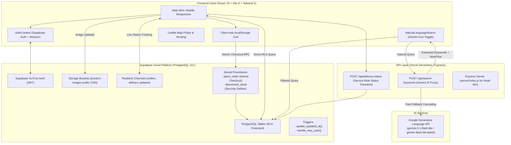

# NearX — Hyperlocal Near-Expiry Deals & Grocery Marketplace

> **NearX** is a production-grade, multi-role hyperlocal marketplace connecting local grocery stores with nearby consumers. The platform enables stores to list near-expiry products at dynamically calculated discounts (10% to 60%+ off), preventing food waste while delivering high-value grocery deals to consumers with real-time delivery and order tracking.

---

## Table of Contents
1. [System Architecture](#system-architecture)
2. [Tech Stack & Runtime Specifications](#tech-stack--runtime-specifications)
3. [Core Business Logic & Dynamic Pricing](#core-business-logic--dynamic-pricing)
4. [Complete Database Schema (Supabase PostgreSQL)](#complete-database-schema-supabase-postgresql)
5. [Transactional Checkout & Inventory Concurrency](#transactional-checkout--inventory-concurrency)
6. [AI Search Architecture (Google Gemini Integration)](#ai-search-architecture-google-gemini-integration)
7. [Frontend Routing & Component Tree](#frontend-routing--component-tree)
8. [API Endpoints Reference](#api-endpoints-reference)
9. [Role-Based Access Control (RBAC) & Security](#role-based-access-control-rbac--security)
10. [Directory Structure](#directory-structure)
11. [Local Development & Environment Setup](#local-development--environment-setup)
12. [Deployment Architecture](#deployment-architecture)

---

## System Architecture



---

## Tech Stack & Runtime Specifications

### Frontend
- **Framework**: React 19 (`react`, `react-dom`)
- **Build Tool**: Vite 6 (`@vitejs/plugin-react`)
- **Styling**: Tailwind CSS v4 (`@tailwindcss/vite`), PostCSS
- **Routing**: React Router v7 (`react-router-dom`)
- **Icons**: Lucide React (`lucide-react`)
- **Maps**: Leaflet (`leaflet`, `react-leaflet`)
- **Charts & Data Viz**: Recharts (`recharts`)
- **Animations**: Framer Motion (`framer-motion`)
- **Date Handling**: date-fns (`date-fns`)
- **HTTP/Database Client**: `@supabase/supabase-js`

### Backend & API
- **Deployment Platform**: Vercel Serverless Functions (`/api/`)
- **Dev Server**: Node.js v20+ / v24+ Express server (`/server/`)
- **Module System**: ECMAScript Modules (`"type": "module"`)
- **AI Engine**: Google Gemini API (`generativelanguage.googleapis.com/v1beta`)
  - Cascading low-latency models: `gemini-3.1-flash-lite` -> `gemini-flash-lite-latest` -> `gemini-3.5-flash-lite` -> local heuristic keyword extractor fallback

### Database & Cloud Services
- **Database**: Supabase PostgreSQL with strict Row Level Security (RLS)
- **Object Storage**: Supabase Storage bucket (`product-images`)
- **Realtime**: Supabase Realtime subscriptions (PostgreSQL CDC)

---

## Core Business Logic & Dynamic Pricing

### 1. Currency & Financial Representation
> **CRITICAL RULE**: All monetary values in the database, API, and RPC functions are stored as **integers in PAISE** (1 INR = 100 paise).
> Example: ₹96.00 is stored as `9600`. ₹160.00 is stored as `16000`.
> Divide by `100` for display (`₹${(price / 100).toFixed(0)}`).

### 2. Expiry-Based Dynamic Discount Engine
The core value proposition of NearX is progressive discounts that automatically increase as the product approaches its expiration date.

Implemented in `src/utils/discountCalc.js` and synchronized via database triggers/scripts:

| Days Until Expiration | Discount % | Tier / Status | Badge Color | User Urgency |
| :--- | :--- | :--- | :--- | :--- |
| **30+ days** | **10% OFF** | `active` | Green (`#22C55E`) | Safe / Regular Deal |
| **15 – 30 days** | **25% OFF** | `active` | Emerald (`#10B981`) | Value Deal |
| **7 – 15 days** | **40% OFF** | `buy_soon` | Amber (`#F59E0B`) | Buy Soon |
| **1 – 6 days** | **60% OFF** | `last_chance`| Red (`#EF4444`) | Last Chance / Steal |
| **< 0 days (Expired)**| **60% OFF** | `expired` | Gray (`#6B7280`) | Inactive (`is_active = false`) |

#### Calculation Formula
```javascript
const daysUntilExpiry = Math.ceil((new Date(expiryDate) - new Date()) / (1000 * 60 * 60 * 24));

let discountPercent = 10;
let status = 'active';

if (daysUntilExpiry <= 0) {
  discountPercent = 60;
  status = 'expired';
} else if (daysUntilExpiry <= 7) {
  discountPercent = 60;
  status = 'last_chance';
} else if (daysUntilExpiry <= 15) {
  discountPercent = 40;
  status = 'buy_soon';
} else if (daysUntilExpiry <= 30) {
  discountPercent = 25;
  status = 'active';
} else {
  discountPercent = 10;
  status = 'active';
}

const salePrice = Math.round(mrp * (1 - discountPercent / 100));
```

---

## Complete Database Schema (Supabase PostgreSQL)

### Custom Enum Types
```sql
CREATE TYPE user_role AS ENUM ('customer', 'store_owner', 'delivery_partner', 'admin');
CREATE TYPE order_status AS ENUM ('placed', 'accepted', 'packed', 'out_for_delivery', 'delivered', 'cancelled');
CREATE TYPE product_status AS ENUM ('active', 'buy_soon', 'last_chance', 'expired');
CREATE TYPE payment_status AS ENUM ('pending', 'paid', 'failed', 'refunded');
CREATE TYPE delivery_status AS ENUM ('assigned', 'picked_up', 'in_transit', 'delivered', 'failed');
CREATE TYPE notification_type AS ENUM ('order_update', 'deal_alert', 'expiry_warning', 'system');
```

### Tables Definition

#### 1. `profiles`
Extends `auth.users` with application profile data:
- `id` (UUID, PK): References `auth.users(id)` ON DELETE CASCADE.
- `role` (`user_role`): Default `'customer'`.
- `full_name` (TEXT): User's display name.
- `phone` (TEXT, UNIQUE): Contact number.
- `avatar_url` (TEXT): Profile photo link.
- `is_active` (BOOLEAN): Default `true`.
- `created_at` / `updated_at` (TIMESTAMPTZ).

#### 2. `stores`
Stores registered by `store_owner` profiles (1:1 ownership):
- `id` (UUID, PK): `gen_random_uuid()`.
- `owner_id` (UUID, UNIQUE): References `profiles(id)`.
- `name` (TEXT): Name of supermarket / store.
- `description` (TEXT): Store summary.
- `address`, `city`, `pincode` (TEXT).
- `lat`, `lng` (DECIMAL(10,7)): Geolocation coordinates for Leaflet maps.
- `phone` (TEXT), `logo_url` (TEXT).
- `is_active` (BOOLEAN): Default `true`.
- `avg_rating` (DECIMAL(2,1)): Default `0.0`.
- `total_reviews` (INTEGER): Default `0`.

#### 3. `products`
The core catalog table:
- `id` (UUID, PK): `gen_random_uuid()`.
- `store_id` (UUID, FK): References `stores(id)`.
- `name` (TEXT): Product title (e.g., "Amul Butter 500g", "Quaker Oats 1kg").
- `brand` (TEXT): Brand name (e.g., "Amul", "Cadbury", "Tata").
- `category` (TEXT): `'Dairy'`, `'Bakery'`, `'Snacks'`, `'Beverages'`, `'Pantry'`, `'Cleaning'`.
- `description` (TEXT): Product details.
- `image_url` (TEXT): CDN URL pointing to Supabase Storage `product-images` bucket.
- `mrp` (INTEGER): Maximum Retail Price in **paise** (`CHECK (mrp > 0)`).
- `discount_percent` (INTEGER): Discount (10, 25, 40, 60).
- `sale_price` (INTEGER): Final selling price in **paise** (`CHECK (sale_price > 0)`).
- `stock` (INTEGER): Units in stock (`CHECK (stock >= 0)`).
- `expiry_date` (DATE): Product expiry date.
- `status` (`product_status`): `'active'`, `'buy_soon'`, `'last_chance'`, `'expired'`.
- `is_active` (BOOLEAN): Visibility flag (`false` hides from catalog).

#### 4. `orders`
One order per store (orders containing items from multiple stores are split automatically into individual store orders during checkout):
- `id` (UUID, PK): `gen_random_uuid()`.
- `customer_id` (UUID, FK): References `profiles(id)`.
- `store_id` (UUID, FK): References `stores(id)`.
- `address_id` (UUID, FK): References `addresses(id)`.
- `status` (`order_status`): `'placed'`, `'accepted'`, `'packed'`, `'out_for_delivery'`, `'delivered'`, `'cancelled'`.
- `subtotal` (INTEGER): Sum of item prices in paise.
- `delivery_fee` (INTEGER): Delivery charge in paise (default ₹40.00 = `4000`).
- `total` (INTEGER): `subtotal + delivery_fee`.
- `savings` (INTEGER): Total discount saved vs MRP in paise.
- `payment_status` (`payment_status`): Default `'pending'`.
- `payment_id` (TEXT): Gateway reference (e.g., Razorpay/COD).

#### 5. `order_items`
Immutable line-item snapshot of products purchased:
- `id` (UUID, PK): `gen_random_uuid()`.
- `order_id` (UUID, FK): References `orders(id)` ON DELETE CASCADE.
- `product_id` (UUID, FK): References `products(id)` ON DELETE SET NULL.
- `product_name` (TEXT): Preserves product name even if product is deleted.
- `quantity` (INTEGER): Purchased quantity.
- `unit_price` (INTEGER): Snapshot price in paise at checkout.
- `total_price` (INTEGER): `unit_price * quantity`.

#### 6. `delivery_assignments`
Tracks delivery partner allocations and transit:
- `id` (UUID, PK): `gen_random_uuid()`.
- `order_id` (UUID, UNIQUE, FK): References `orders(id)`.
- `partner_id` (UUID, FK): References `profiles(id)`.
- `status` (`delivery_status`): `'assigned'`, `'picked_up'`, `'in_transit'`, `'delivered'`, `'failed'`.
- `picked_up_at` / `delivered_at` (TIMESTAMPTZ).
- `earnings` (INTEGER): Partner compensation in paise.

#### 7. `addresses`
Customer delivery addresses with GPS coordinates:
- `id` (UUID, PK), `user_id` (UUID, FK), `label` ('Home'/'Work'), `address_line`, `city`, `pincode`, `lat`, `lng`, `is_default`.

---

## Transactional Checkout & Inventory Concurrency

High-concurrency grocery checkouts risk race conditions where multiple customers attempt to purchase the last unit of a near-expiry item. NearX solves this at the database engine level via an atomic **PostgreSQL Stored Procedure (`place_order`)** with `SECURITY DEFINER`:

### The `place_order` Algorithm
1. **Security & Authorization**: Verifies `auth.uid() = p_customer_id` and checks user role.
2. **Deterministic Row Locking**: Locks product rows in ascending ID order (`FOR UPDATE`) to prevent deadlocks:
   ```sql
   SELECT id, stock, mrp, expiry_date, store_id, name, is_active
   FROM products
   WHERE id IN (SELECT (item->>'product_id')::UUID FROM jsonb_array_elements(p_items))
   ORDER BY id
   FOR UPDATE;
   ```
3. **Inventory & Status Verification**: Confirms every requested product is `is_active = true` and `stock >= requested_quantity`.
4. **Server-Side Price Recalculation**: **Never trusts the client's submitted prices**. Recalculates discounts directly from `expiry_date` and `mrp` to prevent price tampering.
5. **Inventory Decrement**: Atomically reduces `stock = stock - quantity`.
6. **Multi-Store Splitting**: Groups cart items by `store_id` and creates separate `orders` rows with divided delivery fees.
7. **Line Item Insertion**: Populates `order_items` snapshots.
8. **Rollback Guarantee**: If any item is out of stock or invalid, the entire transaction throws an exception and rolls back completely.

---

## AI Search Architecture (Google Gemini Integration)

NearX includes an AI search bar powered by Google Gemini, allowing users to type conversational queries like:
- *"healthy breakfast snacks under 100 rupees"*
- *"cleaning supplies for kitchen floor"*
- *"cold drinks and fruit juices for party"*

### Architecture & Privacy Protection
```
User Search Input -> /api/search-keywords (Vercel Serverless) -> Google Gemini API
                                                                        |
User Browser <-- { keywords: [...], maxPrice: 100 } <-------------------+
      |
Supabase Database Query (.lte('sale_price', 10000) + text matching)
```
1. **API Key Security**: The `GEMINI_API_KEY` is kept strictly server-side in `/api/search-keywords.js`. The client bundle never has access to the key.
2. **Catalog Privacy & Efficiency**: Unlike naïve AI architectures that send thousands of product descriptions to the LLM on every keystroke, NearX uses Gemini as a **semantic keyword extractor**:
   - Query: *"healthy snacks under 100 rupees"*
   - Gemini Output: `{"keywords": ["healthy", "snacks", "granola", "nuts", "oats"], "maxPrice": 100}`
3. **Low-Latency Cascading Fallback**:
   To prevent search stalls caused by temporary Gemini API congestion:
   - Primary model: `gemini-3.1-flash-lite` (fast, lightweight)
   - Secondary model: `gemini-flash-lite-latest`
   - Fallback model: `gemini-3.5-flash-lite`
   - Timeout: Strict `3.5s` abort signal per request.
   - Zero-Downtime Fallback: If all remote AI models are busy or unreachable, a local regex heuristic extractor extracts keywords instantly (0ms latency), ensuring search never fails for users.
4. **Client-Side Filtering**: The frontend queries Supabase directly with the extracted keywords and budget constraints.

---

## Frontend Routing & Component Tree

### Route Map (`src/App.jsx`)
```
/                          LandingPage (Public marketing & role entry)
/login                     LoginPage (Supabase Auth email/password)
/register                  RegisterPage (Role selection: customer / store_owner / delivery_partner)

--- CUSTOMER (Role: 'customer') ---
/home                      CustomerHome (Featured deals, categories, search, stores)
/products                  ProductListingPage (Full catalog, filters, sorting, search)
/product/:id               ProductDetailPage (3D zoom, countdown timer, store info)
/cart                      CartPage (localStorage cart, address selector, checkout)
/orders                    OrderHistoryPage (Order list with status chips)
/track/:id                 OrderTrackingPage (Live status timeline & delivery partner info)
/profile                   CustomerProfile (Addresses, user details)

--- STORE OWNER (Role: 'store_owner') ---
/store/dashboard           StoreOwnerDashboard (Revenue metrics, low-stock alerts, orders)
/store/products            ProductManagementPage (Product CRUD, expiry date setter, image upload)
/store/orders              StoreOrdersPage (Accept, Pack, Ready for delivery actions)

--- DELIVERY PARTNER (Role: 'delivery_partner') ---
/delivery/dashboard        DeliveryDashboard (Available & active delivery orders)
/delivery/history          DeliveryHistoryPage (Completed deliveries & earnings summary)
```

### Core Shared Components
- `ProductCard.jsx`: Reusable product card with discount pill, expiry countdown, and cart increment/decrement.
- `DiscountBadge.jsx`: Dynamic color-coded badge indicating discount percentage.
- `SafetyBadge.jsx`: Visual safety guarantee confirming product authenticity before expiry.
- `ExpiryCountdown.jsx`: Relative countdown ("Expires in 3 days", "Last Chance").
- `NaturalLanguageSearch.jsx`: Gemini-powered conversational search bar with query suggestions.
- `MapPicker.jsx` / `StoreMap.jsx`: Leaflet interactive location selector for store onboarding and customer address geocoding.
- `ProtectedRoute.jsx`: Role-based route guard redirecting unauthorized users.

---

## API Endpoints Reference

### 1. Vercel Serverless (`/api/`)
- **`POST /api/search-keywords`**:
  - Request: `{ "query": "string" }`
  - Response: `{ "keywords": ["string"], "maxPrice": number | null }`
  - Rate Limit: 20 requests/min per IP.
- **`POST /api/delivery-status`**:
  - Request: `{ "assignmentId": "uuid", "status": "picked_up" | "delivered" }`
  - Uses `SUPABASE_SERVICE_ROLE_KEY` to securely bypass RLS for delivery partner status transitions.

### 2. Express Server (`/server/`)
Mirrors serverless endpoints for full local Node.js development without requiring the Vercel CLI.
- Port: `3001` (configurable via `PORT`).
- Routes defined in `server/routes/search.routes.js` and `server/routes/delivery.routes.js`.

---

## Role-Based Access Control (RBAC) & Security

### Row Level Security (RLS) Policies
- **`profiles`**:
  - Users can read all active profiles.
  - Users can update only their own profile (`auth.uid() = id`).
- **`products`**:
  - Anyone (public/anon) can view `is_active = true` products.
  - Store owners can insert/update/delete products belonging to their store (`store_id IN (SELECT id FROM stores WHERE owner_id = auth.uid())`).
- **`stores`**:
  - Anyone can view active stores.
  - Only store owners can update their own store details.
- **`orders`**:
  - Customers can read and create their own orders.
  - Store owners can view orders addressed to their store.
  - Delivery partners can view orders assigned to them.
- **`delivery_assignments`**:
  - Partners can view assignments assigned to their ID.

---

## Directory Structure

```
NearX/
├── api/                           # Vercel Serverless Functions
│   ├── search-keywords.js         # Gemini AI keyword extraction proxy
│   └── delivery-status.js         # Privileged delivery status transitions
├── database/                      # SQL Migrations & Database Scripts
│   ├── schema.sql                 # Base table declarations
│   ├── complete_setup.sql         # Full single-run setup (tables, triggers, seed)
│   ├── rls_policies.sql           # Complete Row Level Security policies
│   └── migrations/
│       └── 20261017_place_order_transaction.sql # Atomic place_order RPC
├── scripts/                       # Maintenance & Seeding Utilities
│   ├── distribute-expiry.js       # Balances product expiry dates across tiers
│   ├── fix-quaker-image.js        # Product image maintenance script
│   └── sync-user-images.js        # Syncs user-uploaded images across duplicate rows
├── server/                        # Express Backend (Local Development)
│   ├── config/gemini.config.js    # Gemini API configuration
│   ├── routes/search.routes.js    # Express search endpoints
│   ├── services/searchKeywords.service.js # Canonical keyword extractor
│   └── server.js                  # Express entry point
├── src/                           # Frontend React Application
│   ├── api/                       # Supabase client query modules
│   │   ├── products.js
│   │   ├── orders.js
│   │   └── stores.js
│   ├── components/                # Modular UI Components
│   │   ├── common/                # Shared layout elements (Navbar, Footer)
│   │   ├── customer/              # Customer-specific components (Search, Filter)
│   │   ├── delivery/              # Delivery tracking cards
│   │   ├── shared/                # Universal components (ProductCard, Badges, Toast)
│   │   └── store/                 # Store dashboard & inventory components
│   ├── context/                   # React Contexts (AuthContext.jsx)
│   ├── hooks/                     # Custom hooks (useCart, useAuth, useProducts)
│   ├── pages/                     # Routed Page Views (grouped by role)
│   ├── utils/                     # Business logic (discountCalc.js, formatters.js)
│   ├── App.jsx                    # Route definitions and application shell
│   └── main.jsx                   # React DOM root entry
├── vercel.json                    # Vercel deployment routes and rewrites
├── package.json                   # Project dependencies and npm scripts
└── README.md                      # Comprehensive project documentation
```

---

## Local Development & Environment Setup

### 1. Prerequisites
- Node.js v20.x or v24.x
- npm or pnpm
- Supabase account & project

### 2. Environment Variables Configuration
Create a `.env` file in the root directory:
```env
# Client-Side (Vite)
VITE_SUPABASE_URL=https://your-project.supabase.co
VITE_SUPABASE_ANON_KEY=your-supabase-anon-key
VITE_BACKEND_URL=http://localhost:3001

# Server-Side Only (Never exposed to browser)
GEMINI_API_KEY=your-gemini-api-key
SUPABASE_SERVICE_ROLE_KEY=your-supabase-service-role-key
```

### 3. Database Initialization
1. In the Supabase Dashboard, open the **SQL Editor**.
2. Run `database/complete_setup.sql`.
3. In Supabase **Storage**, ensure a public bucket named `product-images` is created.

### 4. Running the Dev Environment

#### Running Frontend (Vite)
```bash
npm install
npm run dev
# Starts at http://localhost:5173
```

#### Running Backend API Server (Optional - for local Express development)
```bash
cd server
npm install
npm start
# Starts at http://localhost:3001
```

#### Running with Vercel CLI (Exact production simulation)
```bash
npm install -g vercel
vercel dev
```

---

## Deployment Architecture

- **Frontend & Serverless Hosting**: [Vercel](https://vercel.com).
- **Production URL**: `https://near-x-eight.vercel.app`
- **Continuous Deployment**: Connected to the GitHub repository. Pushes to `main` trigger automatic build and deployment.
- **Production Environment Variables**: Set in Vercel Project Settings:
  - `VITE_SUPABASE_URL`
  - `VITE_SUPABASE_ANON_KEY`
  - `GEMINI_API_KEY`
  - `SUPABASE_SERVICE_ROLE_KEY`
